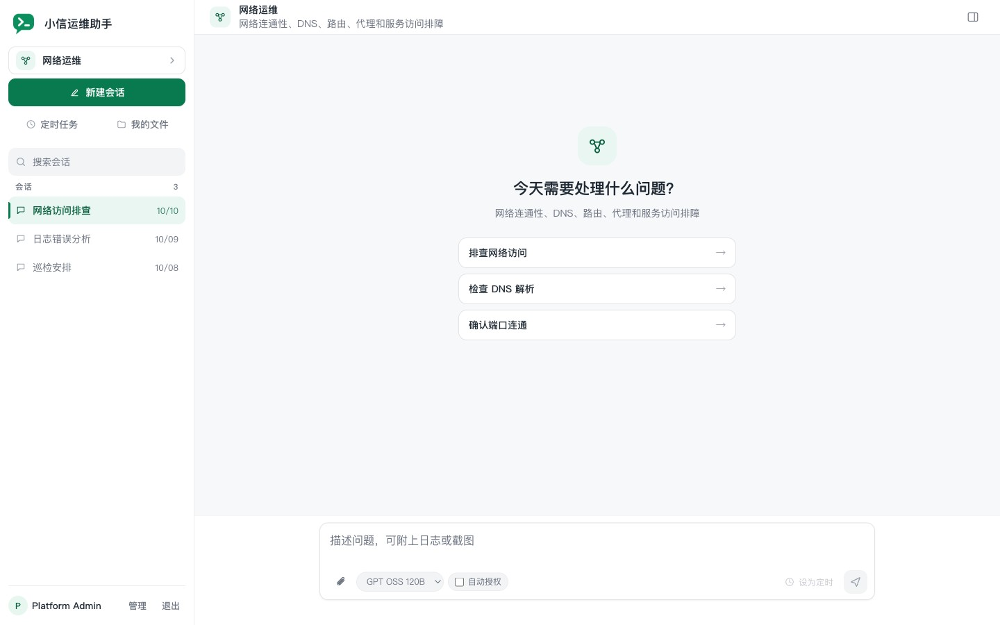
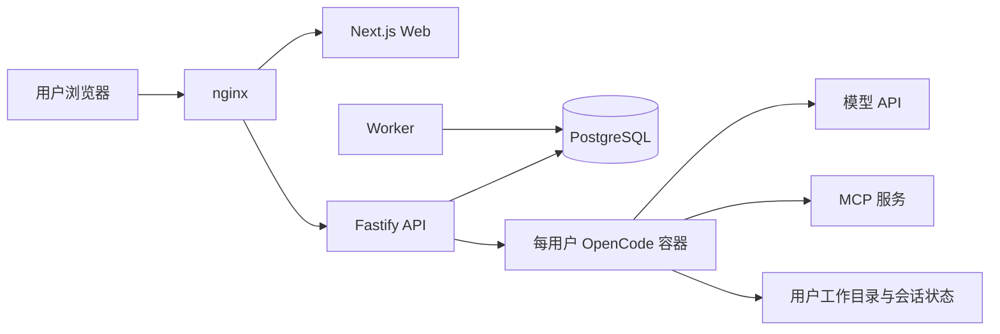

# opshelper（小信运维助手）

**面向运维团队的 AI 工作台。**



opshelper 将智能体、模型连接、工具和执行环境集中管理，让运维人员通过对话完成日志分析、故障排查、文件处理和定时巡检。管理员维护团队共用的能力并按用户分配，每位用户拥有独立的工作目录、会话历史和执行容器。

## 解决什么问题

将 AI 用于日常运维，除了模型问答，还需要接入实际工具、执行脚本、处理文件，并管理不同人员的使用权限。opshelper 为这些工作提供统一入口：

- **减少重复配置**：由管理员维护模型、智能体、Skills 和 MCP 连接，团队成员使用已分配的能力。
- **让任务可以实际执行**：智能体在用户自己的容器中读写文件、运行命令，并通过 MCP 访问外部工具。
- **保留工作过程**：对话、工具调用、协作和执行结果关联保存，便于查看和接续工作。
- **支持周期性工作**：将巡检、查询或报告整理配置为个人定时任务，查看每次执行的状态和结果。

具体能完成哪些运维任务，取决于接入的模型、智能体、Skills、脚本和 MCP 服务。

## 主要功能

| 功能 | 说明 |
| --- | --- |
| 对话工作区 | 实时展示回答、工具调用和执行状态，支持附件、模型切换、取消执行及状态核对 |
| 智能体管理 | 创建、编辑和检查智能体，配置主智能体与子智能体角色，按用户分配 |
| 多智能体协作 | 主智能体可委派给同一用户已获配的子智能体，查看协作过程和结果 |
| Skills 与 MCP | 导入 Skill ZIP、维护脚本和 MCP 连接，将已有工具与操作流程交给智能体使用 |
| 文件管理 | 上传、预览、编辑、下载和整理个人工作目录中的文件，任务产物可直接查看或下载 |
| 定时任务 | 支持周期配置和 Crontab，记录每次运行的状态、结果及关联对话 |
| 执行与审批 | 每用户独立执行队列，支持工具审批、主动提问及每次执行的自动授权设置 |
| 平台管理 | 管理用户、模型连接、全局指令和容器，支持空闲回收、备份与恢复 |

## 技术架构

opshelper 采用 TypeScript，通过 npm workspaces 管理 Web、API、Worker 和共享代码。平台负责用户、权限、配置和任务管理，OpenCode 负责智能体执行。



| 层次 | 技术与职责 |
| --- | --- |
| Web | Next.js 15、React 19，提供对话工作区和管理界面 |
| API | Fastify、Prisma、Dockerode，处理登录、智能体分配、执行队列、配置发布和容器生命周期 |
| Worker | 登记到期任务，回收空闲用户容器；任务执行由 API 统一驱动 |
| 执行环境 | OpenCode 1.18.34，以 `opencode serve` 运行，使用 HTTP API 与 SSE 对接平台 |
| 数据存储 | PostgreSQL 16 保存平台业务数据，宿主目录保存智能体配置、用户文件和 OpenCode 状态 |
| 部署 | Docker Compose 管理平台服务，nginx 提供统一访问入口 |

每位用户使用一个可复用的执行容器。同一用户的多个智能体共享工作目录和会话状态，不同用户使用独立的挂载目录和配置快照。执行容器以非 root 用户运行，根文件系统和受管配置只读，不挂载 Docker socket，也不直接发布宿主端口。

## 部署运行

### 环境要求

- Docker Engine 或兼容运行时，以及 Docker Compose v2。
- Python 3.9+ 和 Bash，用于源码部署工具。
- 部署账号为可访问 Docker socket 的非 root 用户，并具有数据目录的读写权限。
- 可访问的 OpenAI 兼容模型 API；使用 MCP 时，还需确保相应服务可达。

源码构建需要下载基础镜像、npm 与 Python 依赖及 Web 字体资源。每个活动用户的执行容器默认限额为 2 CPU、2 GiB 内存，部署时还需为平台服务、数据库和文件存储预留资源。

### 从源码首次安装

以下步骤用于**全新空数据目录和空数据库**。获取仓库源码后，在仓库根目录执行。

**1. 构建镜像**

```bash
docker build --target api -t opshelper-api:local .
docker build --target worker -t opshelper-worker:local .
docker build --target web -t opshelper-web:local .
docker build -t opshelper/opencode-runtime:1.18.34 deploy/opencode-runtime
```

**2. 生成部署配置**

```bash
python3 scripts/opshelper.py init --project opshelper --port 8080
```

初始化工具生成 `.env` 和 `data/`，自动填写宿主路径、运行身份及随机密码；已有 `.env` 或非空数据目录会被拒绝。

在生成的 `.env` 中增加以下镜像配置，与上面的构建标签对应：

```dotenv
OPSHELPER_API_IMAGE=opshelper-api:local
OPSHELPER_WORKER_IMAGE=opshelper-worker:local
OPSHELPER_WEB_IMAGE=opshelper-web:local
```

其他可配置项见 [.env.example](.env.example)。`DATA_ROOT_HOST` 必须是 Docker daemon 可访问的宿主绝对路径。

**3. 初始化空数据库并启动**

```bash
python3 scripts/opshelper.py bootstrap
python3 scripts/opshelper.py up
python3 scripts/opshelper.py status
curl -f http://127.0.0.1:8080/health
```

`bootstrap` 执行迁移，并仅在所有业务表为空时创建管理员；已有业务数据会被拒绝。`up` 只执行迁移和启动服务。**升级、重启和备份恢复只运行 `up`，不要运行 `bootstrap` 或 seed。**

访问 [http://127.0.0.1:8080/gateway/](http://127.0.0.1:8080/gateway/)。管理员账号为 `admin`，初始密码保存在本机 `.env` 的 `OPSHELPER_ADMIN_PASSWORD` 中。

首次登录后，依次配置模型连接、创建智能体、创建用户并分配智能体。用户配置显示“已就绪”后即可开始对话；具体步骤见[管理员手册](docs/guide/admin.md)。

### 网络与数据

默认入口只监听本机。需要局域网访问时，在 `.env` 中设置 `OPSHELPER_HTTP_HOST` 和 `OPSHELPER_HTTP_PORT`；对外提供服务时应配置 HTTPS。

```text
data/
├── postgres/                 平台数据库
├── agents/<key>/             智能体、Skills、脚本与 MCP 配置
├── config/opencode/          模型连接与全局配置
└── users/<userId>/
    ├── workspace/            用户文件与任务产物
    ├── state/                OpenCode 会话与运行状态
    └── managed/              已分配能力的受管配置快照
```

平台使用宿主目录 bind mount 持久化数据。备份应同时覆盖数据库、用户文件、原生会话状态和配置，操作方法见[备份与恢复](docs/guide/backup-restore.md)。`.env`、模型密钥、运行数据、日志和镜像归档不应提交到 Git。

### 离线部署

Linux x86_64 环境可使用配套离线镜像包，通过 `docker load` 和 Docker Compose 部署。镜像包不包含模型权重、业务数据或凭据，模型与 MCP 服务仍需在部署网络中可达。部署步骤见[离线部署文档](docs/guide/offline-amd64.md)，并以所用发布包内的配置和升级说明为准。

## 开发与校验

本地开发使用 Node.js 22 和 npm。在仓库根目录执行：

```bash
npm ci
npx prisma generate
npm run prisma:validate
npm run typecheck
npm test
npm run build:web
```

| 目录 | 内容 |
| --- | --- |
| `apps/web` | Web 页面和组件 |
| `apps/api` | API 路由、业务服务与容器管理 |
| `apps/worker` | 定时任务登记与空闲容器回收 |
| `packages/shared` | 共享类型和工具 |
| `prisma` | 数据库 schema、迁移与初始化 |
| `deploy` | 运行时镜像定义与 nginx 配置 |
| `scripts` | 部署、备份和验证工具 |
| `examples/opencode-config` | 最小配置示例，不会自动部署 |

## 使用文档

- [贡献指南](CONTRIBUTING.md)
- [管理员手册](docs/guide/admin.md)
- [用户手册](docs/guide/user.md)
- [源码部署](docs/guide/deployment.md)
- [OpenCode 1.18 升级与回退](docs/guide/opencode-1.18-upgrade.md)
- [Linux x86_64 离线部署](docs/guide/offline-amd64.md)
- [备份与恢复](docs/guide/backup-restore.md)
- [故障处理](docs/guide/troubleshooting.md)

## 许可证

项目源码采用 [MIT 许可证](LICENSE)。第三方依赖及自行导入的 Skill、MCP 工具遵循各自的许可证。
